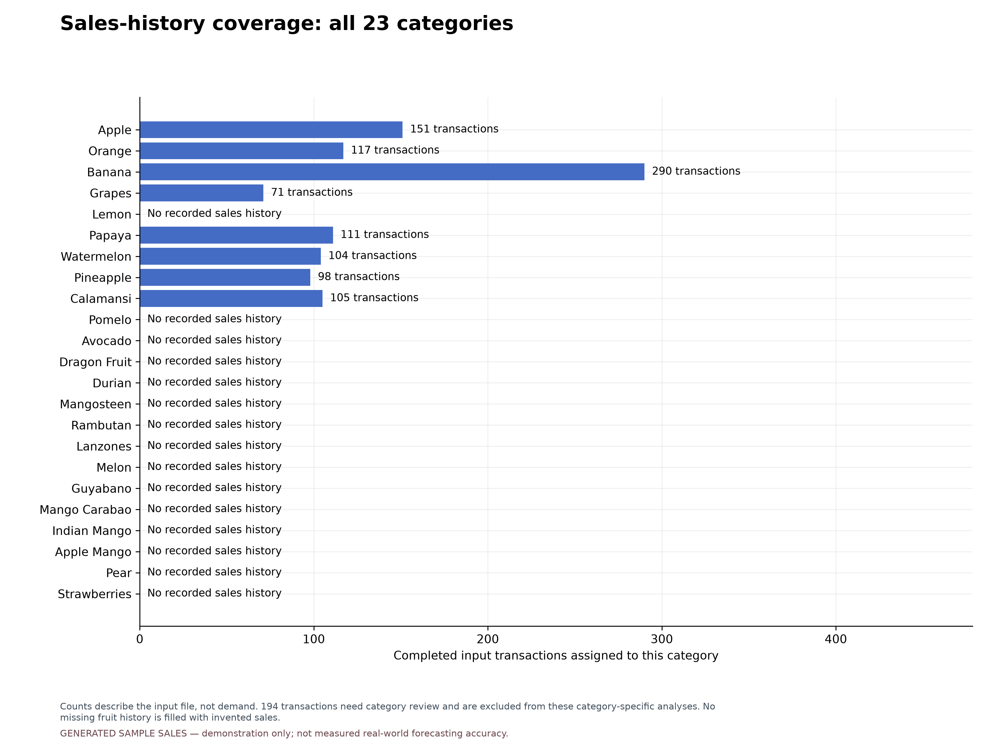
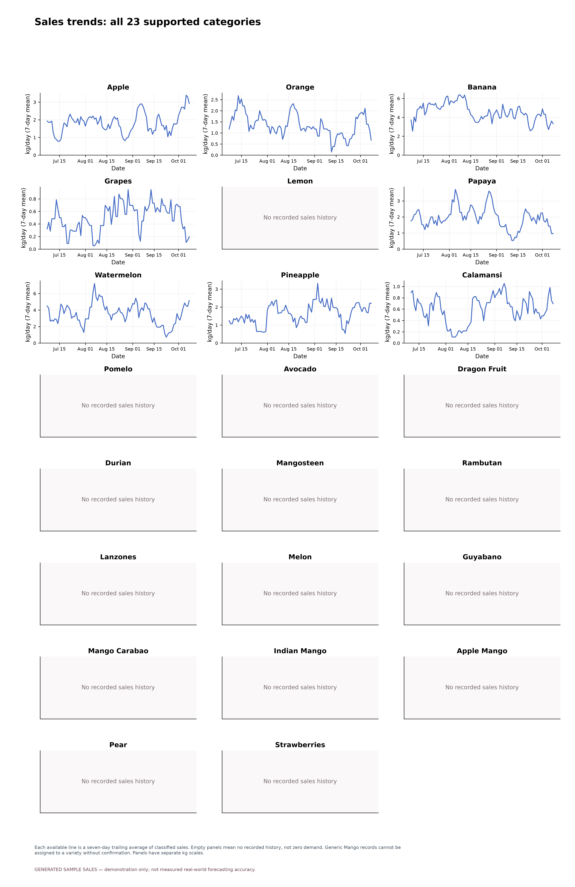
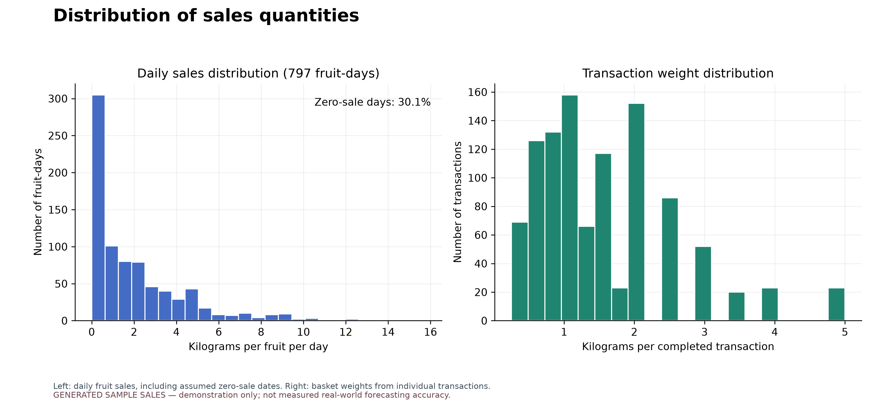
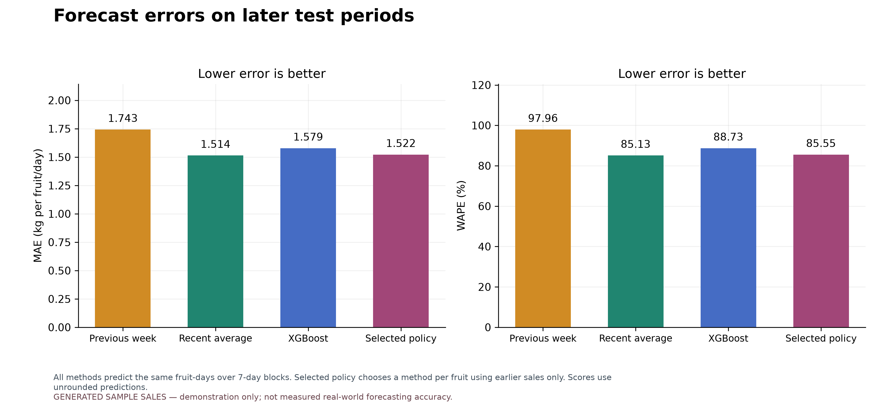
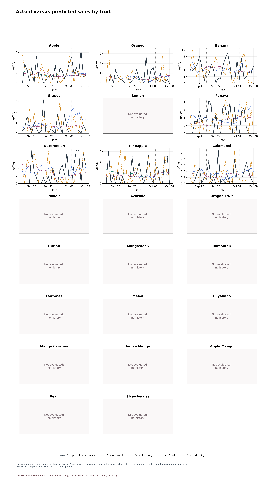
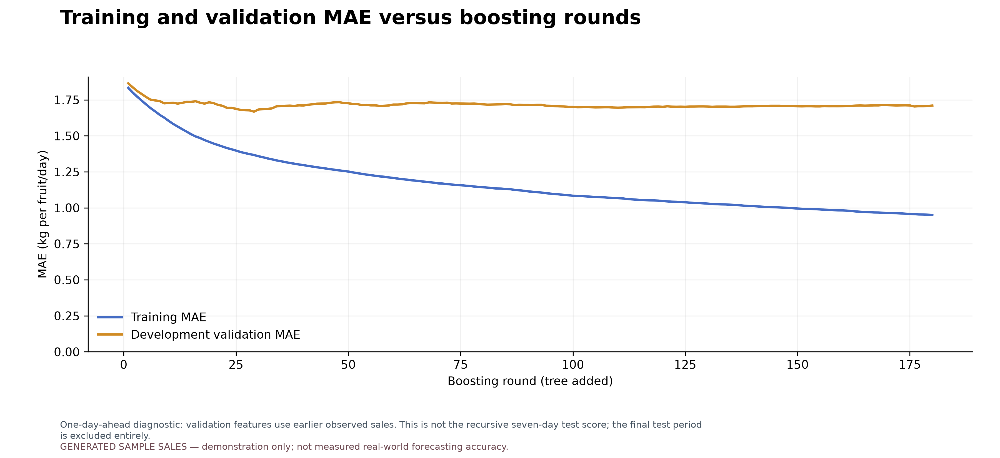
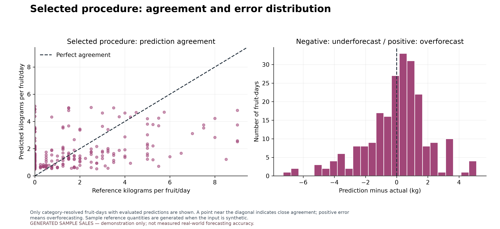
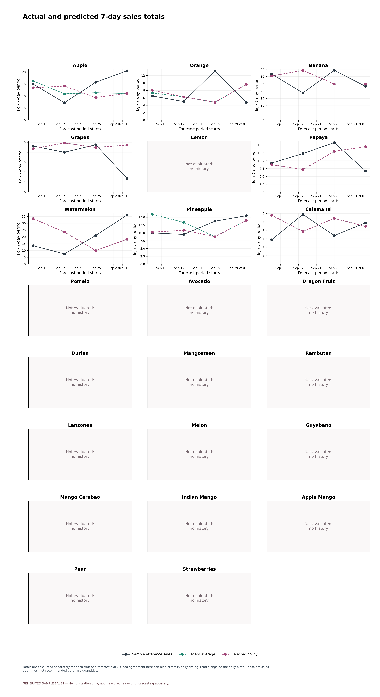
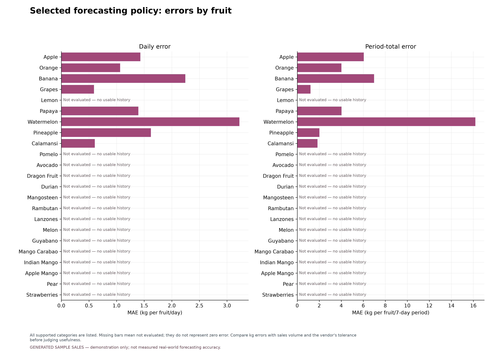
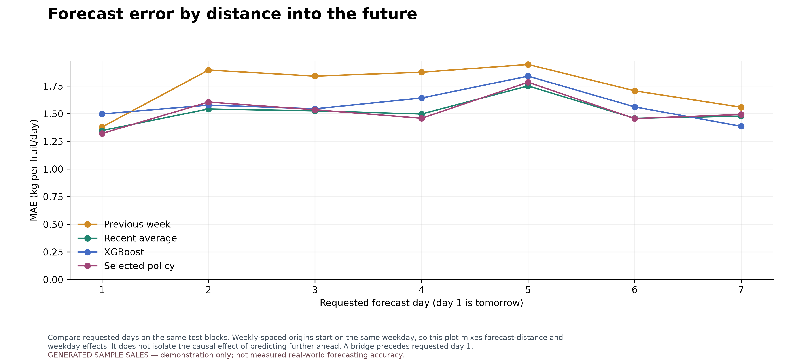

# FruityVens sales analysis and forecast evaluation

**GENERATED SAMPLE SALES — demonstration only; not measured real-world forecasting accuracy.**

Input: `/home/marzomir/Documents/FruityVens/assets/data/cdo_sample_sales_2026.json`. Closed sales dates: 2026-07-01 through 2026-10-08.
Transactions: 1,047; generated: 1,047.
Partial day excluded: 2026-10-09.

## Supported categories and input audit

The agreed catalog contains **23 specific categories**. Guava and generic
Mango are not supported categories. Mango Carabao, Indian Mango, and Apple Mango are separate.
This source file contains 1241 completed closed-day transactions:
**1047** can be assigned to supported categories;
**194** need category review and are excluded from the sales plots,
training, and accuracy calculations below. The original input records have not been relabelled.

| Original label needing review | Transactions | Kilograms | Reason |
| --- | ---: | ---: | --- |
| Mango | 194 | 259.750 | Mango variety unspecified; confirm Mango Carabao, Indian Mango, or Apple Mango |

**8 of 23 categories have usable sales history**.
Every category appears below and in the trend/comparison panels. Missing history means unknown;
it is never represented by invented zero-demand lines or zero prediction errors.

| Supported category | Input transactions | Selling days | Sales-history status | Evaluation status |
| --- | ---: | ---: | --- | --- |
| Apple | 151 | 82 | Sales history available | Sample evaluation only |
| Orange | 117 | 69 | Sales history available | Sample evaluation only |
| Banana | 290 | 93 | Sales history available | Sample evaluation only |
| Grapes | 71 | 48 | Sales history available | Sample evaluation only |
| Lemon | 0 | 0 | No recorded sales history | Not evaluated: no history |
| Papaya | 111 | 69 | Sales history available | Sample evaluation only |
| Watermelon | 104 | 68 | Sales history available | Sample evaluation only |
| Pineapple | 98 | 65 | Sales history available | Sample evaluation only |
| Calamansi | 105 | 63 | Sales history available | Sample evaluation only |
| Pomelo | 0 | 0 | No recorded sales history | Not evaluated: no history |
| Avocado | 0 | 0 | No recorded sales history | Not evaluated: no history |
| Dragon Fruit | 0 | 0 | No recorded sales history | Not evaluated: no history |
| Durian | 0 | 0 | No recorded sales history | Not evaluated: no history |
| Mangosteen | 0 | 0 | No recorded sales history | Not evaluated: no history |
| Rambutan | 0 | 0 | No recorded sales history | Not evaluated: no history |
| Lanzones | 0 | 0 | No recorded sales history | Not evaluated: no history |
| Melon | 0 | 0 | No recorded sales history | Not evaluated: no history |
| Guyabano | 0 | 0 | No recorded sales history | Not evaluated: no history |
| Mango Carabao | 0 | 0 | No recorded sales history | Not evaluated: no history |
| Indian Mango | 0 | 0 | No recorded sales history | Not evaluated: no history |
| Apple Mango | 0 | 0 | No recorded sales history | Not evaluated: no history |
| Pear | 0 | 0 | No recorded sales history | Not evaluated: no history |
| Strawberries | 0 | 0 | No recorded sales history | Not evaluated: no history |

## Chronological test design

The first development period ends 2026-09-09. The service chooses a method
separately for each fruit using up to four earlier forecast windows and lowest daily MAE.
The initial choice is **Per-fruit selection**.
The later test period runs 2026-09-11 through 2026-10-08,
with 4 successive 7-day blocks. Each block trains on
records ending two calendar days before the first forecast date, reproducing the app's one-day
incomplete-ledger bridge. The bridge is predicted recursively and not scored. The model is refit
before later blocks using only data available at that block's origin; no actual sale within its
forecast horizon is supplied back as an input. This is rolling operational evaluation, not one
single 28-day-ahead forecast.

All methods score the same 224 fruit-days. **Selected policy** is the
system's actual procedure: choose the method for each fruit using only records available before
each block, then score it on the later sales. Earlier test-block sales can enter training and
selection for later blocks once they would have become available. They never enter an earlier
forecast. The policy is not a fourth machine learning model. Fixed candidate scores remain visible.
Default XGBoost parameters are reused; no tuning uses the upcoming block. Previously examined
datasets cannot serve as fresh confirmatory experiments. The bundled generated sample has already
been examined during development and remains a demonstration.

## Comparison on the test periods

| Method | MAE (kg/fruit/day) | RMSE (kg/fruit/day) | WAPE | Bias (kg/fruit/day) |
| --- | ---: | ---: | ---: | ---: |
| Weekly seasonal naive | 1.743 | 2.518 | 97.96% | +0.043 |
| Recent average | 1.514 | 2.051 | 85.13% | +0.054 |
| XGBRegressor | 1.579 | 2.079 | 88.73% | +0.207 |
| Selected policy | 1.522 | 2.057 | 85.55% | +0.013 |

MAE = mean absolute prediction error. RMSE emphasizes larger misses.
WAPE = sum of absolute errors / total actual kilograms × 100; it is undefined when total actual sales
are zero. Bias = mean(prediction − actual); positive means overforecasting. WAPE is an error
percentage, not classification accuracy. Do not report 100 − WAPE as a generic accuracy score.

## Quantities over a planning period

The period is **7 days**. There are
32 complete fruit-periods per method. These errors first sum
sales within each fruit/period, then compare totals; they differ from averaging daily errors.

| Method | MAE (kg/fruit/period) | WAPE of period totals | Total underforecast (kg) | Total overforecast (kg) |
| --- | ---: | ---: | ---: | ---: |
| Recent average | 5.354 | 43.00% | 79.608 | 91.735 |
| Selected policy | 5.289 | 42.47% | 83.124 | 86.130 |
| Weekly seasonal naive | 5.770 | 46.33% | 87.500 | 97.125 |
| XGBRegressor | 5.646 | 45.34% | 67.120 | 113.547 |

Underforecast and overforecast compare predictions with recorded sales. They are **not measured
stockouts, lost sales, leftover stock, or spoilage**. Those outcomes require stock and operational
records. Daily errors must still be checked because fruit is perishable and the timing matters.

## What a vendor can assess

| Fruit | Daily MAE (kg) | Period MAE (kg) | Daily improvement vs recent average | Days within tolerance | Periods within tolerance | Evidence status |
| --- | ---: | ---: | ---: | ---: | ---: | --- |
| Apple | 1.430 | 6.048 | -10.77% | Not assessed | Not assessed | Sample demonstration only |
| Orange | 1.065 | 4.016 | -0.81% | Not assessed | Not assessed | Sample demonstration only |
| Banana | 2.246 | 6.985 | 0.00% | Not assessed | Not assessed | Sample demonstration only |
| Grapes | 0.590 | 1.205 | 0.00% | Not assessed | Not assessed | Sample demonstration only |
| Lemon | Not assessed | Not assessed | Not assessed | Not assessed | Not assessed | Not evaluated: no history |
| Papaya | 1.394 | 4.022 | 0.00% | Not assessed | Not assessed | Sample demonstration only |
| Watermelon | 3.225 | 16.181 | 0.00% | Not assessed | Not assessed | Sample demonstration only |
| Pineapple | 1.621 | 2.011 | 5.10% | Not assessed | Not assessed | Sample demonstration only |
| Calamansi | 0.606 | 1.845 | 0.00% | Not assessed | Not assessed | Sample demonstration only |
| Pomelo | Not assessed | Not assessed | Not assessed | Not assessed | Not assessed | Not evaluated: no history |
| Avocado | Not assessed | Not assessed | Not assessed | Not assessed | Not assessed | Not evaluated: no history |
| Dragon Fruit | Not assessed | Not assessed | Not assessed | Not assessed | Not assessed | Not evaluated: no history |
| Durian | Not assessed | Not assessed | Not assessed | Not assessed | Not assessed | Not evaluated: no history |
| Mangosteen | Not assessed | Not assessed | Not assessed | Not assessed | Not assessed | Not evaluated: no history |
| Rambutan | Not assessed | Not assessed | Not assessed | Not assessed | Not assessed | Not evaluated: no history |
| Lanzones | Not assessed | Not assessed | Not assessed | Not assessed | Not assessed | Not evaluated: no history |
| Melon | Not assessed | Not assessed | Not assessed | Not assessed | Not assessed | Not evaluated: no history |
| Guyabano | Not assessed | Not assessed | Not assessed | Not assessed | Not assessed | Not evaluated: no history |
| Mango Carabao | Not assessed | Not assessed | Not assessed | Not assessed | Not assessed | Not evaluated: no history |
| Indian Mango | Not assessed | Not assessed | Not assessed | Not assessed | Not assessed | Not evaluated: no history |
| Apple Mango | Not assessed | Not assessed | Not assessed | Not assessed | Not assessed | Not evaluated: no history |
| Pear | Not assessed | Not assessed | Not assessed | Not assessed | Not assessed | Not evaluated: no history |
| Strawberries | Not assessed | Not assessed | Not assessed | Not assessed | Not assessed | Not evaluated: no history |

Positive improvement means the selected procedure beat the recent-average baseline on the same
fruit-days; negative means it did worse. Zero baseline error makes the percentage undefined.
Daily tolerance: **Not assessed**;
period-total tolerance: **Not assessed**;
required share within tolerance: **Not assessed**.
These limits must be chosen with the vendor before checking the final evaluation. No universal
acceptable percentage is assumed. Meeting a chosen target on these records does not guarantee
future performance. The current app supplies fruit prices but no usable stock quantities, so
forecasts describe expected sales and do not calculate an order quantity.

## Interpretation and limits

The sales-history plots are exploratory and do not measure forecast accuracy. The learning curve
is a separate one-day-ahead development diagnostic; it uses observed earlier validation-day sales
as lag features. It must not be confused with the recursive seven-day test results. Historical
seasonality comes from the same bundled PSA features as the production server. Missing dates
after a fruit's introduction are assumed to have zero recorded sales, as in the app. Closures,
stockouts, and missing uploads cannot be distinguished from zero demand. The target is recorded
sales, not unconstrained customer demand. Fruits absent from a block's training history are not
evaluated in that block. History declared complete: False.
Assumed zero fruit-days: 240. Results from generated records demonstrate the pipeline, not measured
real-world vendor performance. No phone, Firebase, or hosted-service records were read or changed.

## Files

- `index.html`: local visual report; open in any browser.
- `all_figures.pdf`: all 12 figures in one document.
- `predictions.csv`: every model/date/fruit prediction, actual, signed error, and absolute error.
- `actual_vs_predicted.csv`: actual kilograms, the three candidate forecasts, and the selected policy.
- `model_metrics.csv`, `fruit_metrics.csv`, `block_metrics.csv`, `horizon_metrics.csv`: error tables.
- `period_predictions.csv`, `period_metrics.csv`, `fruit_period_metrics.csv`: total quantities and errors per planning period.
- `vendor_assessment.csv`: per-fruit baseline comparison and chosen tolerance checks.
- `selection_history.csv`: the method chosen before each fruit's test block.
- `daily_sales.csv`: daily kilograms, revenue in centavos, transaction counts, and price per fruit.
- `category_coverage.csv`: every supported category and its history/evaluation status.
- `category_review.csv`: completed records requiring a specific supported fruit label.
- `input_reconciliation.json`: original, included, and excluded transaction/weight/revenue totals.
- `learning_curve.csv`: training and development-validation MAE by boosting round.
- `development_selection.json`: initial per-fruit choices using earlier validation records.
- `run_metadata.json`: source hashes, dates, parameters, and library versions.

## Figures

### Sales-history coverage: all 23 categories

Counts describe the input file, not demand. 194 transactions need category review and are excluded from these category-specific analyses. No missing fruit history is filled with invented sales.

[PDF](00_category_coverage.pdf)

### Daily sales and revenue

Completed sales assigned to supported categories only; 194 unresolved/out-of-scope transactions are excluded. Weight and revenue are separate measures; the trailing average summarizes past sales.

[PDF](01_daily_sales.pdf)

### Sales trends: all 23 supported categories

Each available line is a seven-day trailing average of classified sales. Empty panels mean no recorded history, not zero demand. Generic Mango records cannot be assigned to a variety without confirmation. Panels have separate kg scales.

[PDF](02_fruit_trends.pdf)

### Distribution of sales quantities

Left: daily fruit sales, including assumed zero-sale dates. Right: basket weights from individual transactions.

[PDF](03_sales_distribution.pdf)

### Average sales by day of week

Summary of classified sales in the available period. For the bundled sample, higher weekend transaction counts were deliberately programmed; this is not evidence of real vendor weekday demand.

[PDF](04_weekday_sales.pdf)

### Forecast errors on later test periods

All methods predict the same fruit-days over 7-day blocks. Selected policy chooses a method per fruit using earlier sales only. Scores use unrounded predictions.

[PDF](05_model_comparison.pdf)

### Actual versus predicted sales by fruit

Dotted boundaries mark new 7-day forecast blocks. Selection and training use only earlier sales; actual sales within a block never become forecast inputs. Reference actuals are sample values when the dataset is generated.

[PDF](06_actual_vs_predicted.pdf)

### Training and validation MAE versus boosting rounds

One-day-ahead diagnostic: validation features use earlier observed sales. This is not the recursive seven-day test score; the final test period is excluded entirely.

[PDF](07_learning_curve.pdf)

### Selected procedure: agreement and error distribution

Only category-resolved fruit-days with evaluated predictions are shown. A point near the diagonal indicates close agreement; positive error means overforecasting. Sample reference quantities are generated when the input is synthetic.

[PDF](08_prediction_errors.pdf)

### Actual and predicted 7-day sales totals

Totals are calculated separately for each fruit and forecast block. Good agreement here can hide errors in daily timing; read alongside the daily plots. These are sales quantities, not recommended purchase quantities.

[PDF](09_period_sales.pdf)

### Selected forecasting policy: errors by fruit

All supported categories are listed. Missing bars mean not evaluated; they do not represent zero error. Compare kg errors with sales volume and the vendor's tolerance before judging usefulness.

[PDF](10_fruit_errors.pdf)

### Forecast error by distance into the future

Compare requested days on the same test blocks. Weekly-spaced origins start on the same weekday, so this plot mixes forecast-distance and weekday effects. It does not isolate the causal effect of predicting further ahead. A bridge precedes requested day 1.

[PDF](11_horizon_errors.pdf)
