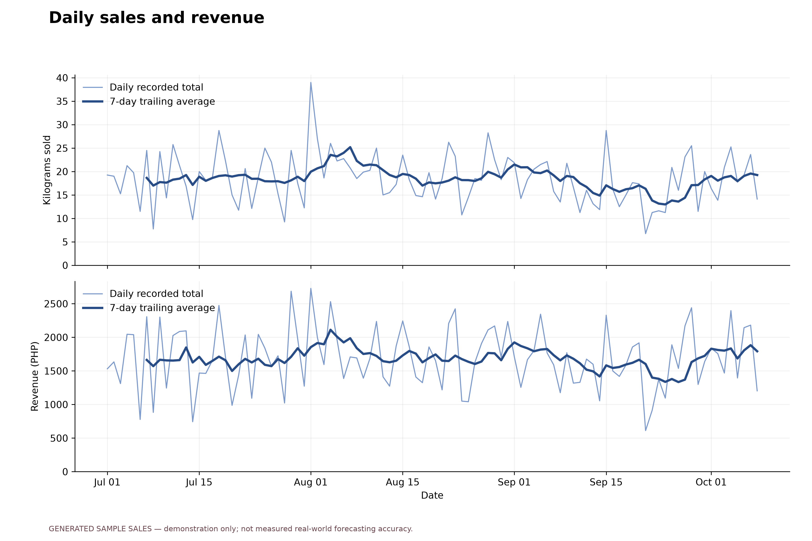
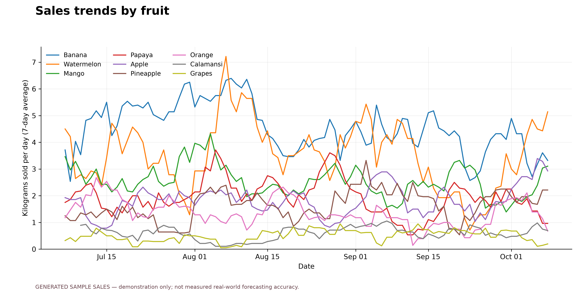
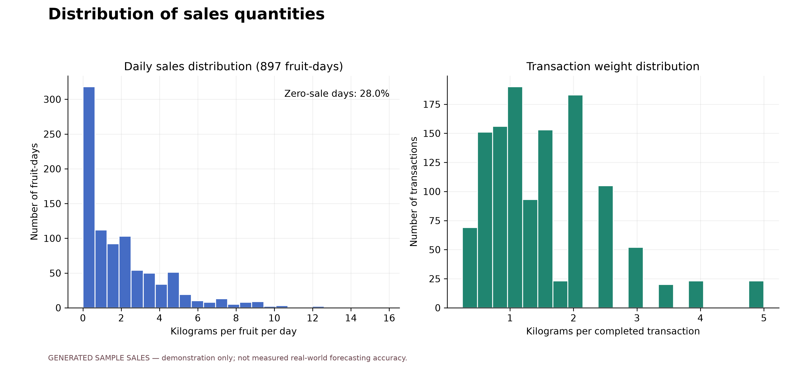
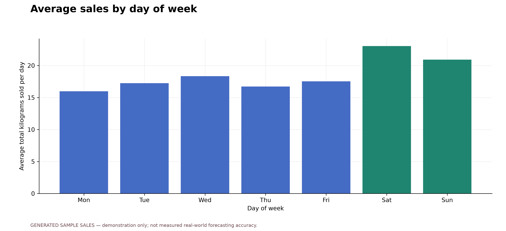
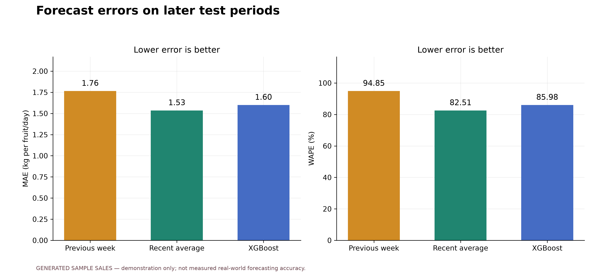
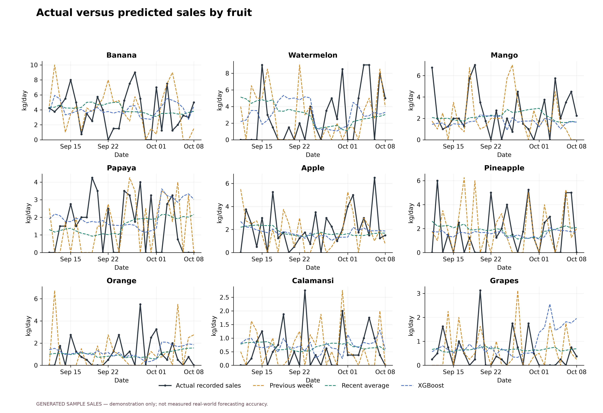
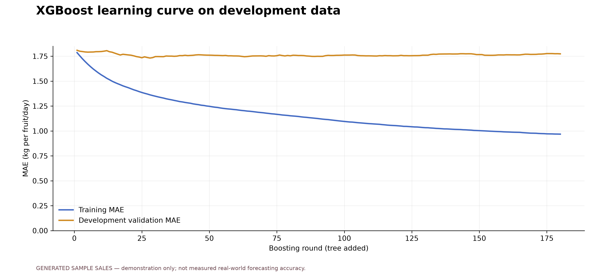
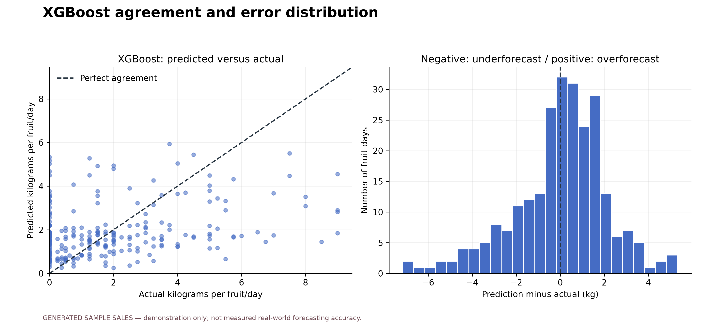

# FruityVens sales analysis and forecast evaluation

**GENERATED SAMPLE SALES — demonstration only; not measured real-world forecasting accuracy.**

Input: `/home/marzomir/Documents/FruityVens/assets/data/cdo_sample_sales_2026.json`. Closed sales dates: 2026-07-01 through 2026-10-08.
Transactions: 1,241; generated: 1,241.
Partial day excluded: 2026-10-09.

## Chronological test design

The first development period ends 2026-09-09. Model selection uses only that period,
with the server's two historical seven-day validation windows. The selected method is
**Recent average** and is fixed before inspecting test results.
The later test period runs 2026-09-11 through 2026-10-08,
with 4 successive 7-day blocks. Each block trains on
records ending two calendar days before the first forecast date, reproducing the app's one-day
incomplete-ledger bridge. The bridge is predicted recursively and not scored. The model is refit
before later blocks using only data available at that block's origin; no actual sale within its
forecast horizon is supplied back as an input. This is rolling operational evaluation, not one
single 28-day-ahead forecast.

All models score the same 252 fruit-days.
The numerically lowest test score is descriptive; the test period is not used to retune the model
or retrospectively change the development-selected method. Default production parameters are reused.

## Comparison on the test periods

| Method | MAE (kg/fruit/day) | RMSE (kg/fruit/day) | WAPE | Bias (kg/fruit/day) |
| --- | ---: | ---: | ---: | ---: |
| Weekly seasonal naive | 1.764 | 2.515 | 94.85% | -0.004 |
| Recent average | 1.535 | 2.063 | 82.51% | +0.011 |
| XGBRegressor | 1.599 | 2.132 | 85.98% | +0.036 |

MAE = mean absolute prediction error. RMSE emphasizes larger misses.
WAPE = sum of absolute errors / total actual kilograms × 100; it is undefined when total actual sales
are zero. Bias = mean(prediction − actual); positive means overforecasting. WAPE is an error
percentage, not classification accuracy. Do not report 100 − WAPE as a generic accuracy score.

## Interpretation and limits

The sales-history plots are exploratory and do not measure forecast accuracy. The learning curve
is a separate one-day-ahead development diagnostic; it uses observed earlier validation-day sales
as lag features. It must not be confused with the recursive seven-day test results. Historical
seasonality comes from the same bundled PSA features as the production server. Missing dates
after a fruit's introduction are assumed to have zero recorded sales, as in the app. Closures,
stockouts, and missing uploads cannot be distinguished from zero demand. The target is recorded
sales, not unconstrained customer demand. Fruits absent from a block's training history are not
evaluated in that block. Results from generated records demonstrate the pipeline, not measured
real-world vendor performance. No phone, Firebase, or hosted-service records were read or changed.

## Files

- `index.html`: local visual report; open in any browser.
- `all_figures.pdf`: all eight figures in one document.
- `predictions.csv`: every model/date/fruit prediction, actual, signed error, and absolute error.
- `actual_vs_predicted.csv`: side-by-side actual kilograms and all three forecasts.
- `model_metrics.csv`, `fruit_metrics.csv`, `block_metrics.csv`, `horizon_metrics.csv`: error tables.
- `daily_sales.csv`: daily kilograms, revenue in centavos, transaction counts, and price per fruit.
- `learning_curve.csv`: training and development-validation MAE by boosting round.
- `development_selection.json`: the model comparison conducted before the test period.
- `run_metadata.json`: source hashes, dates, parameters, and library versions.

## Figures

### Daily sales and revenue

Completed transactions only. Weight and revenue are separate measures; the trailing average summarizes past sales.

[PDF](01_daily_sales.pdf)

### Sales trends by fruit

Each line is a seven-day trailing average, not a fitted forecast or proof of annual seasonality.

[PDF](02_fruit_trends.pdf)

### Distribution of sales quantities

Left: daily fruit sales, including assumed zero-sale dates. Right: basket weights from individual transactions.

[PDF](03_sales_distribution.pdf)

### Average sales by day of week

An exploratory summary of the available period; differences do not establish a causal weekday effect.

[PDF](04_weekday_sales.pdf)

### Forecast errors on later test periods

All methods predict the same fruit-days with a recursive seven-day horizon. Errors are computed before rounding; these are test scores, not training scores.

[PDF](05_model_comparison.pdf)

### Actual versus predicted sales by fruit

Forecasts are issued in separate seven-day blocks with a one-day bridge. Models refit before each block; actual values within a block never become recursive forecast inputs.

[PDF](06_actual_vs_predicted.pdf)

### XGBoost learning curve on development data

One-day-ahead diagnostic: validation features use earlier observed sales. This is not the recursive seven-day test score; the final test period is excluded entirely.

[PDF](07_learning_curve.pdf)

### XGBoost agreement and error distribution

A point near the diagonal indicates close agreement. Signed errors show the direction of misses; opposite errors do not cancel in MAE or WAPE.

[PDF](08_prediction_errors.pdf)
